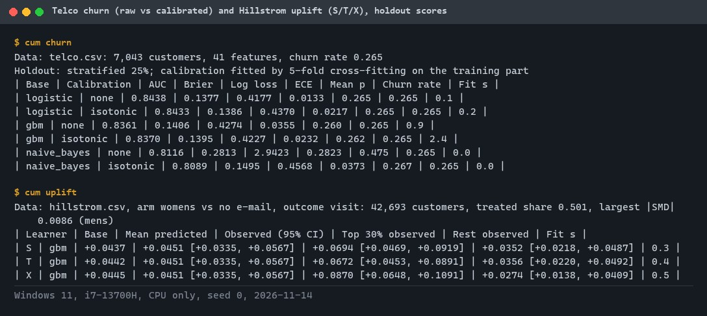
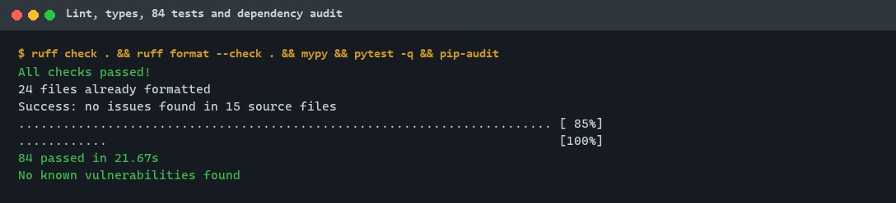
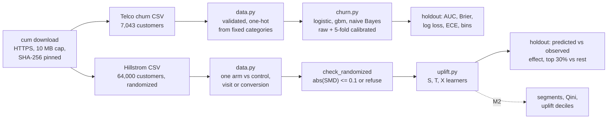
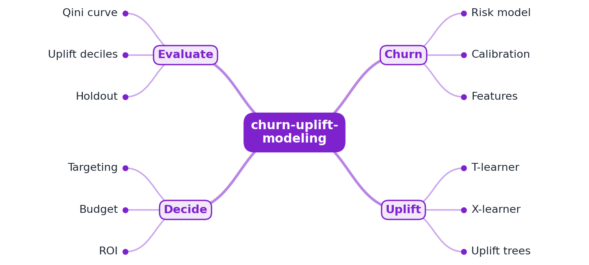

# churn-uplift-modeling

[](https://github.com/EquinoxWN/churn-uplift-modeling/actions/workflows/ci.yml)


> Discounts go to customers who would have stayed anyway: predict not just who will churn but who will respond to an offer. M1 fits churn models with cross-fitted probability calibration on the IBM Telco data, and S-, T- and X-learner uplift models on the randomized Hillstrom e-mail test, each scored on a holdout.

Part of my **AI and Machine Learning** list · Python · core project

## Proof it works

On the Telco holdout (1,761 customers) the churn models rank well (AUC 0.81 to 0.84), and
calibration is shown next to each raw model: it brings gradient boosting's expected calibration
error from 0.036 to 0.023 and repairs naive Bayes (0.282 to 0.037), while the already calibrated
logistic regression gets slightly worse (0.013 to 0.022). On the Hillstrom women's e-mail test,
every uplift learner's mean prediction (+0.044 to +0.045) lies inside the observed holdout effect
on visits, +0.045 [+0.034, +0.057]:



84 tests pass (calibration against known probabilities, learners against planted effects, metrics
on worked examples, malformed-file refusals, verified downloads), and the dependency audit is clean:



## Architecture

**What M1 runs today:**



**Full roadmap (M1 to M3):**



## How it works

_Steps 1 and 2 are built and tested; the rest is on the [roadmap](#roadmap)._

1. A churn model predicts who is likely to leave, with calibrated probabilities.
2. Using randomized campaign data, uplift models estimate how much an offer changes each customer's behaviour.
3. Customers are split into persuadables, sure things, lost causes and 'do not disturb'.
4. Qini curves and uplift-by-decile charts evaluate the models on a holdout set.
5. A campaign simulation compares targeting by churn risk with targeting by uplift under a fixed budget.
6. The write-up explains why the highest-risk customers are often the wrong ones to target.

Details of M1:

- **Calibration:** `CalibratedClassifierCV` with 5 folds; each fold's calibrator sees only
  predictions for customers its classifier did not train on. Isotonic by default, sigmoid with
  `--calibration sigmoid`. Raw and calibrated models are always printed side by side
  ([ADR 0003](docs/adr/0003-calibrate-by-cross-fitting-and-report-raw-too.md)).
- **Uplift learners:** S (one model with the offer as an input), T (one model per arm) and X
  (Kuenzel et al., 2019: impute each arm's effects with the other arm's model, then blend by the
  treated share), on logistic or gradient-boosting bases, written on scikit-learn
  ([ADR 0002](docs/adr/0002-own-meta-learners-on-scikit-learn.md)).
- **Randomization gate:** before any uplift model is fitted, feature means are compared between
  arms; a standardized mean difference above 0.1 on any feature stops the run.
- **Holdout check:** the mean predicted uplift is compared with the observed difference in visit
  rates (95% interval), and the 30% of customers with the highest predicted uplift with the rest.
  Qini curves and deciles are M2.

## Who it helps

- **Who:** data scientists and analysts in retention, CRM and marketing teams who decide who gets
  an offer, and engineers who want a tested reference for calibration and uplift learners.
- **The problem:** churn scores are used as if they were probabilities without checking, and
  offers go to the highest-risk customers without asking whether the offer changes their behaviour.
- **How to use it:** `cum churn` shows, on your holdout, whether a churn model's probabilities can
  be trusted and whether calibration helps; `cum uplift` estimates each customer's response to an
  offer from a randomized test and refuses data that was not randomized. Both write a JSON report.

## Tech stack

| Area | In M1 | Planned |
|---|---|---|
| Core | Python 3.11+, NumPy, scikit-learn (logistic regression, histogram gradient boosting, naive Bayes, `CalibratedClassifierCV`) | uplift trees, comparison with CausalML |
| Data | IBM Telco churn sample, Hillstrom MineThatData e-mail test (both SHA-256 pinned), synthetic data with known truth for tests | |
| Eval | holdout AUC, Brier, log loss, ECE and reliability bins; observed vs predicted effect, top 30% vs rest, randomization check | Qini curves, uplift by decile, budgeted campaign ROI simulation |

Language: **Python** (3.11+). Code in [`src/churn_uplift_modeling/`](src/churn_uplift_modeling): `data.py` (verified downloads, validated loaders), `churn.py` (models, calibration, scoring), `uplift.py` (S/T/X learners, randomization check), `metrics.py`, `synthetic.py` (known-truth data), `files.py` (atomic writes), `cli.py`.

## Run it

**Prerequisites:** Python 3.11+ (CI uses 3.12). CPU only. About 5 MB of disk for the two datasets
and a few hundred MB of memory for the runs.

```bash
python -m venv .venv && source .venv/bin/activate   # Windows: .venv\Scripts\activate
make setup      # install the package and dev tools
make lint       # ruff, ruff format, mypy --strict
make test       # 84 tests on hand-written files and synthetic data, no download
make run        # download Telco and Hillstrom into data/ (SHA-256 checked), print both tables
```

More runs:

```bash
cum churn --bases gbm --calibration sigmoid --json .tmp/churn.json
cum uplift --arm mens --outcome conversion --base logistic
cum uplift --synthetic --size 50000        # known effects: adds correlation and RMSE vs truth
```

No environment variables are read. Thread use of scikit-learn can be limited with the standard
OpenMP variable `OMP_NUM_THREADS` (the local check sets 2). Downloaded data stays in `data/` and is
never committed; no model files are saved.

## Tests and results

Full numbers and the analysis: [docs/results/m1.md](docs/results/m1.md). Quality check (10 rules,
12 hand mutations): [docs/quality/2026-11-01.md](docs/quality/2026-11-01.md).

| Test file | Tests | What it proves |
|---|---|---|
| `test_data.py` | 33 | Telco one-hot encoding on a worked row; blank `TotalCharges` allowed only at tenure 0; 19 kinds of malformed values refused; repeated ids, missing columns, short rows, non-UTF-8 and oversized files refused; Hillstrom arm and outcome selection; download kept only with the right SHA-256, HTTPS only, size cap exact, retries bounded with backoff, no partial file |
| `test_metrics.py` | 13 | Brier, log loss, reliability bins, ECE, AUC (ties, brute-force check), difference in means with its interval and SMD on worked examples; bad inputs refused |
| `test_churn.py` | 7 | Calibrated probabilities within 0.06 of the true probabilities; calibration repairs an overconfident model (isotonic and sigmoid); ranking follows the planted driver; every base scored raw and calibrated on one holdout; same seed, same scores; bad inputs refused |
| `test_uplift.py` | 14 | T and X (logistic, gbm) and S (gbm) recover planted effects (correlation > 0.7, persuadables positive, 'do not disturb' negative); a linear S-learner cannot rank; no effect gives near-zero predictions; X-learner blend and propensity; holdout top 30% beats the rest; the randomization check flags targeted and moderately imbalanced offers |
| `test_cli.py` | 17 | Churn and uplift tables and UTC JSON; real-format files end to end; 9 bad argument cases exit 2; bad data exits 2 with a message; targeted offers refused before fitting; downloads use the pinned URL and checksum; a failed write keeps the old file; version |

| Check | Result |
|---|---|
| Tests | **84 passed**, 0 failed |
| Telco churn, holdout AUC | logistic 0.844, gbm 0.836 raw / 0.837 calibrated, naive Bayes 0.812 / 0.809 |
| Telco churn, holdout ECE raw to isotonic | logistic 0.013 to 0.022; gbm 0.036 to 0.023; naive Bayes 0.282 to 0.037 |
| Hillstrom women's e-mail, visits | observed +0.0451 [+0.0335, +0.0567]; mean predicted S +0.0437, T +0.0442, X +0.0445 (gbm) |
| Hillstrom, top 30% vs rest (gbm) | S +0.069 vs +0.035; T +0.067 vs +0.036; X +0.087 vs +0.027 |
| Synthetic, correlation with true effect | S 0.93, T 0.73, X 0.81 (gbm); linear S-learner 0.04 |
| Mutation check | 10 of 12 killed first, 12 of 12 after two added tests |
| Lint / audit | ruff, ruff format, mypy `--strict` clean; `pip-audit`: no known vulnerabilities |

CI (lint, tests, audit, synthetic and public-data runs on Ubuntu, Python 3.12) is configured but
has not run yet.

## Roadmap

**M1** (≈15 h)
- [x] Write `docs/rfc/0001-design.md`: problem, goals, non-goals, chosen design
- [x] A churn model predicts who is likely to leave, with calibrated probabilities.
- [x] Using randomized campaign data, uplift models estimate how much an offer changes each customer's behaviour.

**M2** (≈20 h)
- [ ] Customers are split into persuadables, sure things, lost causes and 'do not disturb'.
- [ ] Qini curves and uplift-by-decile charts evaluate the models on a holdout set.

**M3** (≈25 h)
- [ ] A campaign simulation compares targeting by churn risk with targeting by uplift under a fixed budget.
- [ ] The write-up explains why the highest-risk customers are often the wrong ones to target.
- [ ] Publish the proof below with real numbers

## Proof

What this repo must show before it counts as done:

- Qini scores per model, and simulated campaign ROI for risk-based vs uplift-based targeting.

| Result | Value |
|---|---|
| M3 proof above | Not measured yet (M2/M3). Current M1 numbers: see [Tests and results](#tests-and-results). |

## Why it matters

- **Interview angle:** 'Who should get the retention discount?' causal-ML product questions.
- **Upstream I'd like to contribute to:** CausalML (Uber): examples or docs.

## Design docs

- [RFC 0001: design](docs/rfc/0001-design.md)
- [ADR 0001: record architecture decisions](docs/adr/0001-record-architecture-decisions.md)
- [ADR 0002: own S/T/X meta-learners on scikit-learn](docs/adr/0002-own-meta-learners-on-scikit-learn.md)
- [ADR 0003: calibrate by cross-fitting, report the raw model too](docs/adr/0003-calibrate-by-cross-fitting-and-report-raw-too.md)
- [M1 results](docs/results/m1.md)
- [Quality check 2026-11-01](docs/quality/2026-11-01.md)

## Scope

This is a learning and portfolio system, not a hosted production service. Everything runs locally.
The Telco data is a fictional IBM sample; results do not describe a real company.

## Security and contributing

- Every GitHub Action is pinned to a commit SHA; workflows run read-only, without persisted credentials.
- Dependabot update pull requests are paused (`open-pull-requests-limit: 0`) so the repository keeps a single `main` branch; dependencies are updated by hand and checked by the CI audit.
- Datasets are downloaded only over HTTPS, capped at 10 MB and refused unless their SHA-256 matches the pinned value; input files are size-capped and validated before use; CI runs `pip-audit` on every push.
- Report vulnerabilities privately: see [SECURITY.md](SECURITY.md). To contribute, see [CONTRIBUTING.md](CONTRIBUTING.md).

## License

MIT, see [LICENSE](LICENSE).
